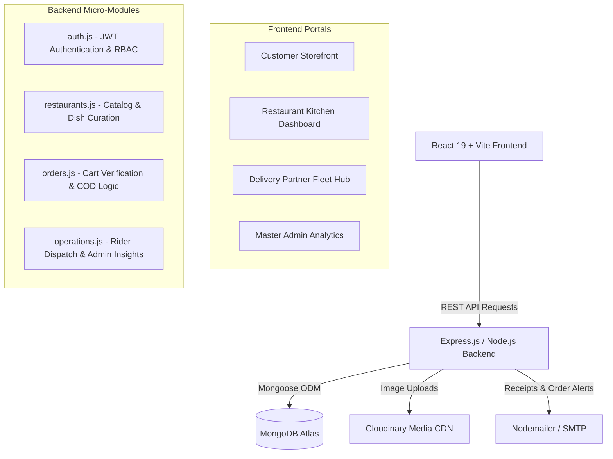

# 🍽️ Foodie — Enterprise Full-Stack Food Delivery Platform

[](https://nodejs.org/)
[](https://expressjs.com/)
[](https://react.dev/)
[](https://vitejs.dev/)
[](https://www.mongodb.com/)
[-F59E0B?style=flat&logo=cashapp&logoColor=white)](#-strict-cash-on-delivery-cod-checkout)

A production-grade, full-stack food ordering and delivery ecosystem built with high performance, strict business integrity, and modern UX aesthetics. Foodie simulates real-world food-tech platforms like Swiggy and Zomato with four dedicated role-based portals, multi-item cart validation, real-time group meal splitting, food surplus rescue deals, and verifiable doorstep Cash-on-Delivery (COD) lifecycle management.

---

## 🌟 Key Highlights & Differentiators

* 💵 **Strict Cash-on-Delivery (COD) Enforcement**: Zero mock gateways. Every transaction simulates physical doorstep cash exchange with one-time verification tokens and delivery partner handshakes.
* 👥 **Collaborative Group Ordering**: Create shared dining sessions with 6-character codes or 1-click invite URLs. Friends add dishes into a single synchronized cart while tracking per-person subtotals.
* 🌱 **Surplus Rescue Deals**: Dedicated food sustainability marketplace allowing restaurants to post surplus inventory before kitchen closing hours with dynamic discount tags and countdowns.
* 🍱 **Smart Budget Discovery**: Dynamic price filtering letting customers discover complete meals, combos, and snacks tailored to exact wallet budgets.
* 🔐 **Multi-Role Portal Hierarchy**: Separate, protected workspaces for **Customers**, **Restaurant Owners**, **Delivery Partners (Riders)**, and **Platform Admins**.
* ⚡ **Live Order Tracking**: End-to-end timeline tracking every state: `PENDING` ➔ `CONFIRMED` ➔ `PREPARING` ➔ `OUT_FOR_DELIVERY` ➔ `DELIVERED`.
* 📄 **Digital Tax Invoices**: Downloadable, print-ready modal invoices with tax breakdowns, delivery fees, restaurant metadata, and customer address stamps.

---

## 🏗️ System Architecture



---

## 👥 Role-Based Portals & Feature Matrix

| Feature / Capability | Customer | Restaurant Owner | Delivery Partner | Admin |
| :--- | :---: | :---: | :---: | :---: |
| **Browse Restaurant Menus & Filters** | ✅ | ✅ | — | ✅ |
| **Server-Verified Cart & COD Checkout** | ✅ | — | — | — |
| **Host / Join Collaborative Group Orders** | ✅ | — | — | — |
| **Surplus Food Rescue Marketplace** | ✅ | — | — | — |
| **Budget-Based Food Discovery** | ✅ | — | — | — |
| **Real-time Order Status & Invoice Print**| ✅ | ✅ | ✅ | ✅ |
| **Menu Item CRUD & Availability Toggle** | — | ✅ | — | ✅ |
| **Incoming Kitchen Orders & Preparation State** | — | ✅ | — | — |
| **Daily Sales Revenue & Analytics** | — | ✅ | — | ✅ |
| **Available Delivery Job Acceptance** | — | — | ✅ | — |
| **Doorstep Cash Handshake & Mark Delivered** | — | — | ✅ | — |
| **Platform-Wide Overview & User Management**| — | — | — | ✅ |

---

## 🛠️ Technology Stack

### Frontend Client
* **Framework**: React 19 (`react`, `react-dom`)
* **Build Tool**: Vite 8 with Hot Module Replacement (HMR)
* **Routing**: React Router DOM v7
* **Icons**: Lucide React
* **Styling**: Vanilla CSS Design System with curated variables, glassmorphism, responsive cards, and zero bloated CSS dependencies
* **Linting & Code Quality**: Oxlint

### Backend Services
* **Runtime**: Node.js (ES Module syntax)
* **Framework**: Express.js 4.21
* **Database**: MongoDB Atlas via Mongoose 8.9
* **Authentication**: JSON Web Tokens (`jsonwebtoken`) + BcryptJS (`bcryptjs`)
* **Security & Performance**: Helmet HTTP security headers, CORS origin whitelisting, Morgan HTTP logging
* **Media Storage**: Cloudinary SDK
* **Notification Transports**: Nodemailer (SMTP)

---

## 📁 Repository Directory Structure

```text
FOOD-DELIVERY/
├── .gitignore                      # Top-level gitignore guarding secrets and node_modules
├── README.md                       # Master project documentation
│
├── foodie-backend/                 # Node.js + Express API Server
│   ├── .env.example                # Safe environment variable template
│   ├── auth.js                     # User registration, JWT login, profile handlers
│   ├── db.js                       # Mongoose connection pool & health status
│   ├── models.js                   # MongoDB schemas (User, Restaurant, FoodItem, Order, GroupOrder)
│   ├── operations.js               # Rider dispatch, admin metrics, and order lifecycle
│   ├── orders.js                   # Cart validation, group orders, COD checkout
│   ├── restaurants.js              # Restaurant browsing, cuisine filters, dish catalogs
│   ├── seedMegaCatalog.js          # Catalog populator with rich multi-city eateries
│   ├── seedRestaurants.js          # Seed runner for initial dev instances
│   ├── server.js                   # Express server entry point & middleware stack
│   └── utils.js                    # Standardized JSON response helpers (sendSuccess, sendError)
│
└── foodie-frontend/                # React 19 + Vite Single Page Application
    ├── index.html                  # HTML5 entry with responsive viewport tags
    ├── vite.config.js              # Vite configuration
    └── src/
        ├── App.jsx                 # App routing hierarchy & protected routes
        ├── index.css               # Core CSS design tokens (colors, shadows, buttons, badges)
        ├── main.jsx                # React DOM render root
        ├── components/             # Reusable UI components
        │   ├── InvoiceModal.jsx    # Printable PDF-style invoice generator
        │   ├── Navbar.jsx          # Dynamic navigation with role badges & cart drawer
        │   └── primitives.jsx      # Design system badges, skeletons, error banners
        ├── context/                # Global React context state
        │   ├── AuthContext.jsx     # User session, JWT storage, and logout cleanup
        │   └── CartContext.jsx     # Single-restaurant cart validation & state
        └── pages/                  # Route views
            ├── AdminDashboard.jsx  # Platform management & system health
            ├── Auth.jsx            # Sign In / Register / Password Reset
            ├── BudgetDiscovery.jsx # Budget slider menu discovery
            ├── Cart.jsx            # Cart review & server pricing verification
            ├── Checkout.jsx        # COD doorstep address & order placement
            ├── CustomerDashboard.jsx# Customer order history & active deliveries
            ├── GroupOrder.jsx      # Collaborative group ordering hub & item picker
            ├── Home.jsx            # Hero banner, category carousels, restaurant list
            ├── OrderTracking.jsx   # Live chronological order step progression
            ├── OwnerDashboard.jsx  # Kitchen order management & dish menu CRUD
            ├── RestaurantDetail.jsx# Full restaurant menu & dietary filter view
            ├── RiderDashboard.jsx  # Driver available pickups & doorstep COD delivery
            └── SurplusRescue.jsx   # Discounted surplus meal deals
```

---

## ⚡ Quick Start & Local Setup

### 1. Prerequisites
* **Node.js** v20.x or higher
* **npm** v10.x or higher
* **MongoDB Atlas** cluster URI (or local MongoDB running on port 27017)

### 2. Clone the Repository
```bash
git clone https://github.com/BallaJaideep/Food-Delivery.git
cd Food-Delivery
```

### 3. Backend Setup
1. Open a terminal and navigate to the backend directory:
   ```bash
   cd foodie-backend
   npm install
   ```
2. Create your `.env` configuration file:
   ```bash
   cp .env.example .env
   ```
3. Populate `.env` with your actual credentials:
   ```env
   PORT=5000
   NODE_ENV=development
   CLIENT_URL=http://localhost:5173
   MONGODB_URI=your_mongodb_connection_string
   JWT_SECRET=your_jwt_secret_key
   JWT_EXPIRES_IN=7d
   SMTP_HOST=smtp.gmail.com
   SMTP_PORT=465
   SMTP_USER=your_email@gmail.com
   SMTP_PASS=your_email_app_password
   EMAIL_FROM="Foodie Platform <your_email@gmail.com>"
   CLOUDINARY_CLOUD_NAME=your_cloud_name
   CLOUDINARY_API_KEY=your_cloudinary_api_key
   CLOUDINARY_API_SECRET=your_cloudinary_api_secret
   ```
4. Seed demo restaurants and dishes (Optional):
   ```bash
   node seedMegaCatalog.js
   ```
5. Start the backend server:
   ```bash
   npm start
   ```
   *Backend will run at:* `http://localhost:5000`  
   *Health Check:* `http://localhost:5000/api/health`

### 4. Frontend Setup
1. In a new terminal, navigate to the frontend directory:
   ```bash
   cd foodie-frontend
   npm install
   ```
2. Start the Vite development server:
   ```bash
   npm run dev
   ```
   *Frontend will launch at:* `http://localhost:5173` (or `http://localhost:5174` if port 5173 is occupied).

---

## 📡 REST API Reference Summary

### Authentication (`/api/auth`)
* `POST /api/auth/register` — Create new customer, owner, or rider account
* `POST /api/auth/login` — Sign in and obtain JWT bearer token
* `GET /api/auth/me` — Retrieve active authenticated user profile

### Restaurants & Food (`/api/restaurants` & `/api/food`)
* `GET /api/restaurants` — Search restaurants with pagination, city, and cuisine filters
* `GET /api/restaurants/:id` — Get restaurant profile and categorized menu
* `POST /api/restaurants` — Register new eatery (Owner/Admin)
* `GET /api/food/surplus` — Discover time-limited surplus rescue deals
* `GET /api/food/budget` — Discover dishes filtered by max budget threshold

### Orders & Group Meals (`/api/orders`)
* `POST /api/orders/validate-cart` — Server-side cart integrity check & subtotal recalculation
* `POST /api/orders` — Finalize doorstep Cash-on-Delivery order
* `GET /api/orders/my-orders` — View customer's order history
* `GET /api/orders/:id` — Live tracking and invoice details
* `POST /api/orders/group` — Create new synchronized group meal session
* `GET /api/orders/group/:groupCode` — Sync group participant items and calculated subtotal
* `POST /api/orders/group/:groupCode/join` — Join group order by code
* `PUT /api/orders/group/:groupCode/items` — Update participant's selected items
* `POST /api/orders/group/:groupCode/checkout` — Host places COD group order

### Logistics & Operations (`/api/operations`)
* `GET /api/operations/rider/available` — List pending delivery jobs for riders
* `POST /api/operations/rider/accept/:orderId` — Assign order to active rider
* `POST /api/operations/rider/delivered/:orderId` — Confirm cash collection and complete delivery
* `GET /api/operations/admin/metrics` — Platform-wide revenue, order volume, and active riders

---

## 🔒 Security Best Practices Implemented

* **Protected Secrets**: `.env` files and API credentials are kept out of source control via [.gitignore](.gitignore).
* **Cross-Origin Resource Sharing (CORS)**: Strict origin validation allowing only authorized frontend clients.
* **HTTP Security Headers**: Powered by `helmet` to protect against cross-site scripting (XSS) and clickjacking.
* **Stateless Token Auth**: Secure JSON Web Tokens with expiry and cryptographic hashing with `bcryptjs`.
* **Server-Authoritative Pricing**: Frontend prices are treated as untrusted; subtotal, delivery charges, and taxes are strictly calculated and validated against the database upon checkout.

---

## 👨‍💻 Author & Contributions

* **Author**: [Balla Jaideep](https://github.com/BallaJaideep)
* **GitHub Repository**: [https://github.com/BallaJaideep/Food-Delivery](https://github.com/BallaJaideep/Food-Delivery)

Contributions, feature requests, and suggestions are welcome! Feel free to open an issue or pull request.

---

## 📜 License
This project is licensed under the **MIT License** — free to use, modify, and distribute for personal and educational purposes.
